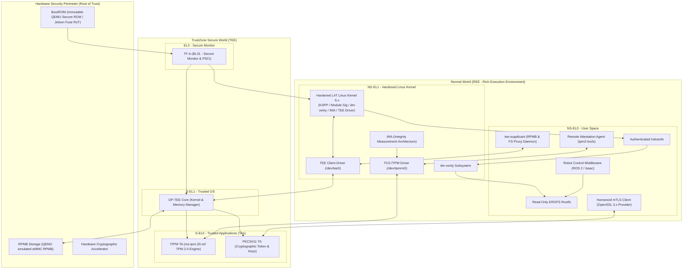
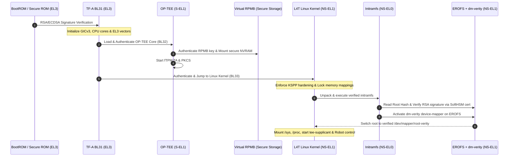
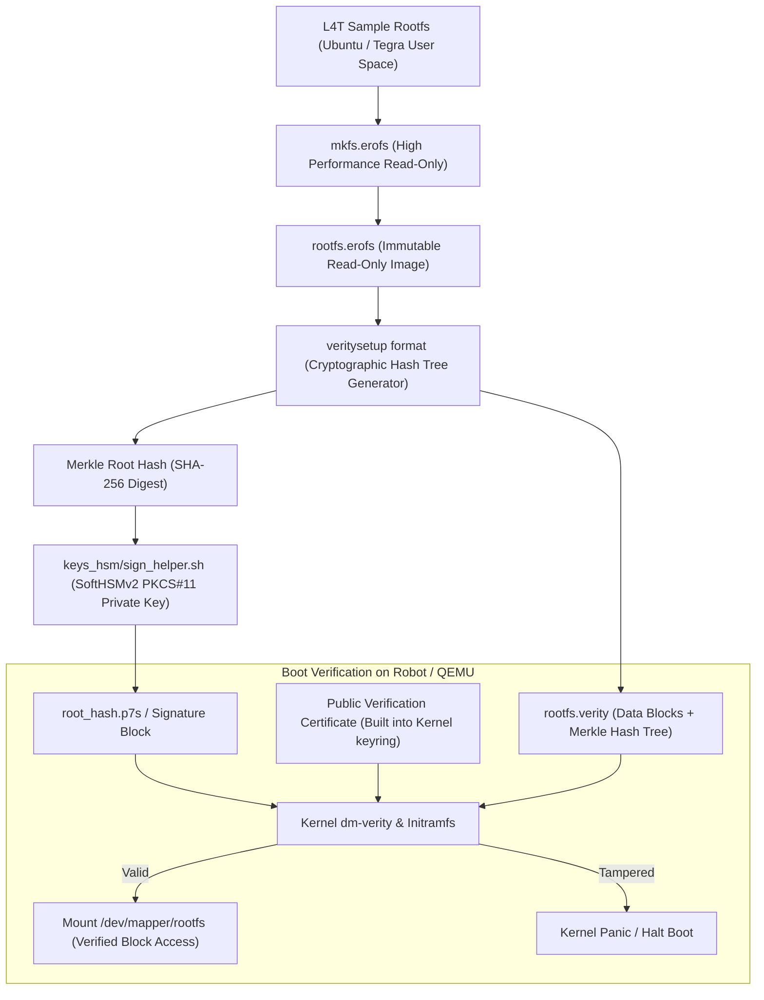
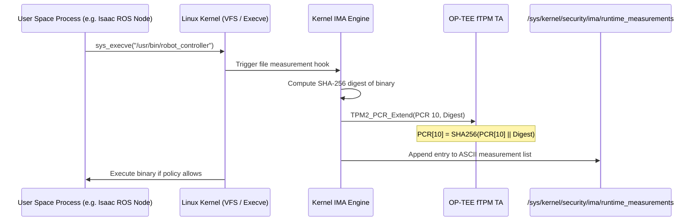

# System Architecture Specification

> **Target Platform**: NVIDIA Jetson Humanoid Robot Control Architecture (L4T 6.x & QEMU aarch64 virt)  
> **Status**: Approved / Baseline

---

## 1. 아키텍처 개요 및 신뢰 경계 (Trust Boundary)

본 플랫폼은 휴머노이드 로봇의 고신뢰성 제어를 위해 **하드웨어 수준의 신뢰 경계(Hardware Trust Boundary)**를 수립하고, ARMv8/ARMv9 TrustZone 기술을 기반으로 보안 영역(Secure World)과 일반 운영체제 영역(Normal World)을 엄격히 분리합니다.



---

## 2. 보안 부팅 체인 (Secure Boot Chain)

시스템은 변조 불가능한 RoT(Root of Trust)에서 시작하여 각 단계의 펌웨어 및 커널 이미지를 암호학적으로 검증한 후 제어권을 넘깁니다.



---

## 3. Dual-Target 커널 빌드 및 하드닝 아키텍처

실제 로봇 하드웨어(NVIDIA Jetson)와 QEMU 에뮬레이터 간의 보안 정책 괴리를 없애기 위해 **3계층 커널 설정 아키텍처**를 채택합니다.

```text
                                [ NVIDIA L4T Base defconfig ]
                               (tegra_defconfig / 공식 BSP 기준)
                                             │
                                             ▼
                      [ configs/kernel/security_hardening.config ]
                  (KSPP 권고안, 모듈 서명 강제, EROFS, dm-verity, IMA, fTPM)
                                             │
                       ┌─────────────────────┴─────────────────────┐
                       │                                           │
                       ▼                                           ▼
             [ Real Jetson Target ]                      [ QEMU virt Target ]
     (실제 Jetson Orin/Thor 플래시 이미지)          + [ configs/kernel/qemu_compat.config ]
                                              (VirtIO 드라이버, PL011 콘솔, QEMU PCI)
```

### 3.1. 보안 하드닝 핵심 파라미터 (`security_hardening.config`)
- **메모리 보호 및 익스플로잇 차단**:
  - `CONFIG_KASLR=y`: 커널 코드 주소 공간 난수화
  - `CONFIG_STRICT_KERNEL_RWX=y` & `CONFIG_STRICT_MODULE_RWX=y`: 실행 가능 메모리에 쓰기 금지 (W^X)
  - `CONFIG_STACKPROTECTOR_STRONG=y`: 스택 버퍼 오버플로우 탐지
  - `CONFIG_FORTIFY_SOURCE=y`: 버퍼 경계 런타임 검사
  - `CONFIG_SLAB_FREELIST_RANDOM=y` & `CONFIG_SLAB_FREELIST_HARDENED=y`: 힙 공격 완화
- **무결성 강제**:
  - `CONFIG_MODULE_SIG=y` & `CONFIG_MODULE_SIG_FORCE=y`: 미서명 커널 모듈 적재 전면 차단
  - `CONFIG_MODULE_SIG_ALL=y` & `CONFIG_MODULE_SIG_SHA256=y`: 빌드 시 자동 서명
  - `CONFIG_DM_VERITY=y` & `CONFIG_DM_VERITY_VERIFY_ROOTHASH_SIG=y`: 루트 해시 서명 검증
  - `CONFIG_EROFS_FS=y`: 초경량 압축 읽기 전용 파일시스템
- **신뢰 환경 및 증명 연동**:
  - `CONFIG_TEE=y` & `CONFIG_OPTEE=y`: OP-TEE SMC 드라이버
  - `CONFIG_TCG_TPM=y` & `CONFIG_TCG_FTPM_TEE=y`: OP-TEE fTPM 통신 드라이버
  - `CONFIG_IMA=y` & `CONFIG_IMA_MEASURE_PCR_IDX=10`: 실행 바이너리 fTPM PCR 10 측정

---

## 4. 스토리지 무결성 파이프라인 (EROFS + dm-verity)

운영체제 런타임 변조 및 랜섬웨어, 지속성(Persistence) 악성코드 주입을 원천 차단하기 위해 루트 파일시스템을 불변(Immutable) 상태로 배포합니다.



---

## 5. 런타임 무결성 측정 (IMA) 및 fTPM PCR 확장 파이프라인

로봇 운영 중 동적으로 로드되는 실행 파일, 스크립트, 공유 라이브러리는 리눅스 IMA 서브시스템에 의해 감시되며, 모든 측정값은 fTPM PCR 10에 즉시 반영됩니다.



---

## 6. QEMU aarch64 가상 에뮬레이션 아키텍처

실제 로봇 보드 없이도 모든 보안 메커니즘을 동일하게 검증할 수 있도록 구성된 QEMU `virt` 머신 토폴로지입니다.

| 항목 | 설정값 / 기술 | 설명 |
| :--- | :--- | :--- |
| **Machine Model** | `virt,secure=on,virtualization=on,gic-version=3` | ARMv8 TrustZone 보안 상태(`secure=on`) 활성화 |
| **CPU** | `cortex-a57` 또는 `cortex-a72` (4 Cores) | aarch64 표준 코어 에뮬레이션 |
| **RAM** | `4096MB` (3072MB Normal World + 1024MB Secure World DRAM) | 메모리 공간 하드웨어 분리 |
| **Secure Storage** | Virtual RPMB Socket (OP-TEE `tee-supplicant` 연동) | Replay-Protected Memory Block 에뮬레이션 |
| **네트워크** | User-net (`hostfwd=tcp::2222-:22,tcp::8443-:8443`) | SSH 디버깅 및 Cloud mTLS 통신 검증 포워딩 |
| **Serial 콘솔** | PL011 UART0 (Normal), UART1 (Secure World OP-TEE Console) | 로그 분리 출력 및 자동화 테스트 캡처 |
