# Feature 04 — EROFS + dm-verity + OverlayFS Storage Integrity Deep-Dive

> **Purpose**: Defines the immutable storage pipeline preventing offline flash chip-off attacks and reconciling runtime write capability with self-healing reboot resilience.  
> **Target Standard**: Linux Device Mapper Verity (`dm-verity`), Enhanced Read-Only File System (`EROFS`), OverlayFS  
> **Status**: Approved / Production Baseline  

---

## 1. Architectural Overview & Merkle Hash Tree Pipeline

The entire robot root filesystem is packaged into a read-only EROFS block device and verified in real time at the 4KB block level via kernel `dm-verity`.

[](../../diagrams/storage_integrity_pipeline.html)
> 💡 *Click to open the [Archify Interactive Viewer](../../diagrams/storage_integrity_pipeline.html) for block hash tree construction and mount stages.*

---

## 2. EROFS (Enhanced Read-Only File System)

- **Fixed-Output Compression & Zero-Copy I/O**:
  - Optimized for robotics and embedded AI. Reads 4096-byte blocks with less than 3% CPU overhead.
- **Inherent Immutability**:
  - Filesystem metadata is strictly read-only, preventing runtime file overwriting.

---

## 3. dm-verity Merkle Tree & Signing Pipeline

Automated in `scripts/build_rootfs.sh`:

1. **Merkle Tree Construction**:
   - Computes SHA-256 digests over all 4KB data blocks and builds a tree yielding a single 64-character Root Hash.
2. **Offline Cryptographic Signing**:
   - Signs the Root Hash using SoftHSMv2 `DmVeritySigningKey` (RSA-PSS 3072, ID `02`):
   ```bash
   sign_helper.sh verity --in build/images/verity.roothash --sig build/images/verity.roothash.sig
   ```
3. **Verified Mounting**:
   - `/init` validates `verity.roothash.sig` before activating `/dev/mapper/root-verity`.

---

## 4. Dual-Profile Architecture

| Profile | Image Path | Size | Purpose |
| :--- | :--- | :---: | :--- |
| **`minimal`** | `build/images/rootfs.erofs` | ~15 MB | Ultra-fast CI/CD regression verification |
| **`ubuntu`** | `build/images/ubuntu_rootfs.erofs` | ~5.4 GB | Complete NVIDIA JetPack 7.2.1 Ubuntu 24.04 LTS Noble userspace |

---

## 5. OverlayFS Runtime Isolation & Self-Healing

```text
/ (Merged Rootfs View)
 ├── upperdir: tmpfs RAM disk (/mnt/overlay/upper)   <── Runtime mutable ephemeral state
 └── lowerdir: /dev/mapper/root-verity (EROFS)       <── dm-verity verified immutable files
```

- Any modifications or malicious drops in RAM disappear completely upon power cycle, restoring a pristine system state.

---

## 6. Tamper-Resistance Proof (ATK-03)

Automated test `test_atk03_dm_verity_offline_corruption_and_ro_enforcement` verifies that a 1-byte data corruption raises `EIO`, and forged Merkle roots are rejected by the HSM signature verifier.

