# Feature 06 — Zero Plaintext Key Policy & Secure World TLS 1.3 mTLS Deep-Dive

> **Purpose**: Defines the cryptographic policy prohibiting plaintext private key storage on disk to prevent device cloning and credential exfiltration, and establishing mutual TLS 1.3 telemetry with keys sealed in OP-TEE.  
> **Target Standard**: RFC 7512 (PKCS#11 URI), RFC 8446 (TLS 1.3), OpenSSL 3.x Provider Architecture  
> **Status**: Approved / Production Baseline  

---

## 1. Architectural Overview & Key Hierarchy

No plaintext private keys (`.pem`, `.key`) are ever stored on the robot's filesystem. All offline build signing and runtime mutual TLS authentication execute exclusively within PKCS#11 hardware security boundaries.

[](../../diagrams/key_hierarchy.html)
> 💡 *Click to open the [Archify Interactive Viewer](../../diagrams/key_hierarchy.html) for Tier 1 offline keys, Tier 2 device sealed keys, and Tier 3 certificates.*

---

## 2. Zero Plaintext Key Policy & Audit Enforcement

- **Policy**: Prohibits private key plaintext files across repositories, build outputs, container layers, and filesystem partitions.
- **`CKA_EXTRACTABLE=FALSE`**:
  - Keys generated inside SoftHSMv2 and OP-TEE PKCS#11 tokens are permanently flagged non-extractable.
- **Automated Audit (`keys_hsm/audit_zero_keys.sh`)**:
  - Scans disk trees for `BEGIN * PRIVATE KEY` markers; immediately halts CI/CD builds if any plaintext key is detected.

---

## 3. Offline SoftHSMv2 Pipeline (RFC 7512 `pkcs11:` URI)

Enables signing build artifacts without exposing private keys:

| Object Label | Algorithm | SoftHSM ID | Usage |
| :--- | :---: | :---: | :--- |
| `KernelModuleSigningKey` | RSA 3072 / SHA-256 | `01` | L4T kernel module (`.ko`) signing & Stage 2 UEFI db auth |
| `DmVeritySigningKey` | RSA 3072 / PSS SHA-256 | `02` | EROFS dm-verity Root Hash signature (`verity.roothash.sig`) |
| `ImaSigningKey` | ECDSA P-384 / SHA-384 | `03` | Runtime IMA xattr execution signing |
| `DeviceEnrollmentCaKey` | ECDSA P-256 / SHA-256 | `04` | Internal CA for issuing robot identity certificates |
| `SecureBootKey` | RSA 3072 / SHA-256 | `06` | Stage 1 BootROM/MB2 Tegra PKC Secure Boot signing |

```bash
sign_helper.sh kmod \
  --uri "pkcs11:token=HumanoidSecToken;object=KernelModuleSigningKey" \
  --in custom_driver.ko
```

---

## 4. Secure World TLS 1.3 mTLS Architecture

Guarantees that even upon total Normal World compromise, robot identity keys cannot be extracted:

[](../../diagrams/secure_mtls_sequence.html)
> 💡 *Click to open the [Archify Interactive Viewer](../../diagrams/secure_mtls_sequence.html) for OpenSSL 3.x Provider and OP-TEE SMC signing flow.*

- **OpenSSL 3.x `pkcs11-provider`**:
  - During the TLS 1.3 handshake, delegates `CertificateVerify` signing to the OP-TEE PKCS#11 TA via SMC calls.
  - Signing executes strictly within TrustZone Secure SRAM.
- **Perfect Forward Secrecy (PFS)**:
  - Ephemeral ECDHE key exchanges prevent retroactive decryption of captured network traffic.

---

## 5. Automated Attack Defense Proof (ATK-05 & ATK-10)

- `test_atk05_key_exfiltration_and_rogue_mtls_client`: Confirms 0 plaintext keys on disk and immediate TLS abort for rogue self-signed client certificates.
- `test_atk10_mitm_network_spoofing_and_pfs_defense`: Confirms immediate client abort when an untrusted MITM proxy presents a fake server certificate.

