# Security Beginner's Guide to Storage Integrity and dm-verity

> **Purpose**: Explains the threat of offline flash chip-off attacks, the limitations of standard read-only mounts, and how Merkle hash trees and the Linux `dm-verity` subsystem enforce immutable storage integrity down to individual 4KB disk blocks in accessible terms.  
> **Audience**: Security beginners, Linux storage/filesystem engineers, embedded robotics developers  
> **Status**: Production Guide  

---

## 1. Physical Attacks: Flash Chip-Off and Storage Tampering

Connected edge systems like humanoid robots and autonomous drones face persistent risks of **physical theft and disassembly**.  
When an attacker gains physical custody of a robot's hardware:

1. **Flash Chip-Off**: Using hot air rework stations, the attacker de-solders the onboard eMMC or UFS chip and seats it in a \$20 USB programmer, mounting the raw filesystem on an external workstation.
2. **Backdoor Injection**: The attacker injects malicious hooks into critical system binaries (`/bin/sh`, `/usr/bin/python3`) or overwrites the root password hash in `/etc/shadow`.
3. **Re-Soldering & Boot**: After re-soldering the modified flash chip, the robot boots normally, executing the attacker's persistent backdoor.

---

## 2. Why `ext4 (ro)` Read-Only Mounts Fail Against Physical Attacks

A frequent misconception is that mounting the root partition as read-only (`mount -o ro /dev/mmcblk0p1 /`) provides security.  
However, **the `ro` flag is merely an in-memory kernel convention honored only while the operating system is actively running**:

- When the board is powered down, the Linux kernel does not exist, and the `ro` rule is meaningless.
- Attackers mount the flash partition in read/write (`rw`) mode on their own laptops and freely alter binary bytes.
- At the next boot, the kernel blindly trusts the modified sectors and executes compromised binaries without suspicion.

Preventing offline physical tampering requires **cryptographic block verification at the storage layer**.

---

## 3. The Mathematics of Merkle Trees (Hash Trees)

Hashing a 10GB filesystem in its entirety at boot causes intolerable startup delays (tens of seconds to minutes).  
The **Merkle Hash Tree** solves this scalability bottleneck through hierarchical hashing:

[](../../diagrams/merkle_tree_verity.html)
> 💡 *Click to open the [Archify Interactive Viewer](../../diagrams/merkle_tree_verity.html) exploring 4KB data blocks and Merkle hash verification ladders.*

### 3.1. How Merkle Trees Work
1. **Leaf Nodes (Data Blocks)**: The entire filesystem is partitioned into fixed 4KB blocks ($D_0, D_1, D_2, \dots$).
2. **Level 0 Hashes**: Each 4KB block is hashed with SHA-256. A single 4096-byte hash block accommodates 128 SHA-256 digests ($4096 \div 32 = 128$).
3. **Hierarchical Compaction**: Intermediate hash blocks are recursively hashed, tapering upward like a pyramid.
4. **Root Hash**: The apex of the pyramid converges into **a single 32-byte Root Hash** representing the cryptographic fingerprint of the entire filesystem!

### 3.2. Single-Byte Tamper Detection
If an attacker modifies even a single byte within a 10GB partition:
- The hash of that specific 4KB data block changes.
- The parent hash block in Level 0 changes.
- The cascading discrepancy propagates upward, **altering the top-level 32-byte Root Hash**.

By cryptographically signing only the 32-byte Root Hash during offline build time, the kernel can authenticate every individual block across the entire filesystem.

---

## 4. Linux `dm-verity`: Real-Time On-The-Fly Verification

The Linux kernel **`dm-verity` (Device Mapper Verity)** subsystem operates at the block I/O layer (`drivers/md/dm-verity.c`):

```text
[Application Executes /bin/bash]
Application  --1. read(/bin/bash) request-->  dm-verity block driver
                                                   |
                                                   +--2. Reads 4KB block from physical flash
                                                   +--3. Calculates Merkle path hash on-the-fly
                                                   |
        [Hash Valid (Clean)]                       |      [Hash Mismatch (Tampering Detected!)]
        +------------------------------------------+      +------------------------------------------+
        | Delivers 4KB page to user space memory   |      | Returns immediate I/O Error (EIO)!       |
        | Process executes normally                |      | Terminates process; corrupted code halts |
        +------------------------------------------+      +------------------------------------------+
```

- **Zero Boot Latency**: `dm-verity` does not read the entire storage drive at boot. Blocks are verified on demand with $O(\log N)$ algorithmic speed only when referenced.
- **Immediate Hard Halt**: If a corrupted block is encountered, the kernel raises an immediate `EIO (Input/Output Error)`, physically preventing malicious code from executing.

---

## 5. Immutable OS & Self-Healing via EROFS + OverlayFS

While system binaries must remain immutable, robots require writable storage for operational telemetry, logs (`/var/log`), and network states.  
Our platform reconciles this through an **EROFS + dm-verity + OverlayFS** architecture:

```text
[Unified Storage Layout]
+--------------------------------------------------------------+
|  Merged Root (/): Unified view seen by applications          |
+--------------------------------------------------------------+
                               |
       +-----------------------+-----------------------+
       | OverlayFS Composition                         |
       v                                               v
+-----------------------------+ +-----------------------------+
| Upper Directory (Writable)  | | Lower Directory (Immutable) |
| - RAM-based tmpfs           | | - EROFS + dm-verity         |
| - Runtime logs, /tmp files  | | - System binaries & shared  |
| - Discarded upon reboot     | | - 100% Read-Only & Verified |
+-----------------------------+ +-----------------------------+
```

1. **Lower Immutable Layer**: The rootfs is compiled as an Enhanced Read-Only File System (**EROFS**) image and protected by `dm-verity`.
2. **Upper Transient Layer**: A RAM-backed **`tmpfs`** serves as the writable overlay layer.
3. **Self-Healing Resilience**: Any runtime modifications or malware infections are confined to the upper RAM layer. **Upon a reboot (power cycle), the RAM layer evaporates**, automatically restoring the robot to its pristine factory-verified state.

---

## 6. Summary

1. **Physical Resistance**: `dm-verity` renders offline flash chip-off attacks futile by verifying data block hashes against an immutable root hash.
2. **Merkle Trees**: Compresses multi-gigabyte disk verification into a single 32-byte cryptographic root.
3. **Real-Time Protection**: Intercepts 4KB I/O requests on-the-fly, returning `EIO` upon single-byte corruptions.
4. **Self-Healing**: EROFS + OverlayFS decouples system integrity from runtime write needs, achieving 100% reboot resilience.
