# Key Management & HSM / mTLS Architecture

> **Security Policy**: Zero Plaintext Key Policy  
> **Target Cryptographic Standards**: PKCS#11 v2.40+, TPM 2.0, OpenSSL 3.x Provider Architecture  
> **Status**: Approved / Baseline

---

## 1. Zero Plaintext Key Policy

- **Core Rule**: Absolute prohibition of plaintext private keys (`.pem`, `.key`) in git commits, CI/CD, and test logs.
- **Offline Build & Release Signing**:
  - Code signing keys (kernel modules, dm-verity root hashes, IMA policies) reside inside **SoftHSMv2 (PKCS#11)** tokens.
  - Build scripts reference keys solely via RFC 7512 **`pkcs11:` URIs**.
  - Replacing environment variables (`PKCS11_MODULE_PATH`, `PKCS11_URI`) allows seamless transition to enterprise HSMs (YubiHSM, Thales, AWS CloudHSM).
- **Runtime Robot Key Shielding**:
  - Robot identity and client mTLS keys are never written to Normal World storage.
  - Generated directly within **OP-TEE PKCS#11 TA** or **fTPM 2.0** as non-extractable cryptographic objects.

---

## 2. Cryptographic Key Hierarchy

[](../diagrams/key_hierarchy.html)
> 💡 *Click to open the [Archify Interactive Diagram](../diagrams/key_hierarchy.html) showing interactions between Tier 1, Tier 2, and Tier 3 keys.*

---

## 3. Offline SoftHSMv2 Pipeline

SoftHSMv2 container token layout and slot mapping specification:

### 3.1. PKCS#11 Tokens & Object Definitions

| Token Label | Object Label | Key Type / Algorithm | Purpose |
| :--- | :--- | :--- | :--- |
| `HumanoidSecToken` | `KernelModuleSigningKey` | RSA 3072 / SHA-256 | L4T kernel module (`.ko`) build integrity signing |
| `HumanoidSecToken` | `DmVeritySigningKey` | RSA 3072 / PSS SHA-256 | EROFS dm-verity Root Hash cryptographic signature |
| `HumanoidSecToken` | `ImaSigningKey` | ECDSA P-384 / SHA-384 | Runtime executable IMA xattr signature |
| `HumanoidSecToken` | `DeviceEnrollmentCaKey` | ECDSA P-256 / SHA-256 | Issues robot mTLS device certificates |

### 3.2. Signing Utility Wrapper (`keys_hsm/sign_helper.sh`)
```bash
# Kernel module signing example (zero plaintext exposure)
sign_helper.sh kmod \
  --uri "pkcs11:model=SoftHSM%20v2;token=HumanoidSecToken;object=KernelModuleSigningKey;type=private" \
  --in build/drivers/custom_driver.ko

# dm-verity Root Hash signing example
sign_helper.sh verity \
  --uri "pkcs11:model=SoftHSM%20v2;token=HumanoidSecToken;object=DmVeritySigningKey;type=private" \
  --hash "${ROOTHASH}" \
  --out build/root_hash.p7s
```

---

## 4. Secure World Cloud-Humanoid mTLS Architecture

- **Communication Security Policy**: Mandatory TLS 1.3 Mutual Authentication (mTLS) for all robot telemetry and cloud RPC control channels.
- **Provider Architecture**: OpenSSL 3.x `pkcs11-provider` transparently delegates TLS handshake cryptographic signing to OP-TEE without application code changes.

```text
  [ Normal World (Non-Secure EL0) ]
┌─────────────────────────────────────────────────────────────┐
│  Robot Cloud Agent (apps/mtls_client)                       │
│  ├── Standard OpenSSL 3.x API (SSL_CTX_use_certificate)   │
└───────────────────────────────┬─────────────────────────────┘
                                │
                                ▼
┌─────────────────────────────────────────────────────────────┐
│  OpenSSL 3.x Core Architecture                              │
│  ├── Default Provider (AES-GCM, SHA256, TLS 1.3 State)      │
│  └── PKCS#11 Provider (pkcs11-provider.so)                  │
└───────────────────────────────┬─────────────────────────────┘
                                │ (PKCS#11 API: C_SignInit, C_Sign)
                                ▼
┌─────────────────────────────────────────────────────────────┐
│  OP-TEE Client Library (libckteec.so)                       │
│  └── /dev/tee0 (TEEC_InvokeCommand via Linux Kernel)        │
└───────────────────────────────┬─────────────────────────────┘
                                │
════════════════════════════════╪═══════════════════════════════ (SMC Call: TrustZone Boundary)
                                │
  [ Secure World (S-EL1 / S-EL0) ]
                                ▼
┌─────────────────────────────────────────────────────────────┐
│  OP-TEE OS (S-EL1)                                          │
│  └── PKCS#11 Trusted Application (S-EL0 TA)                 │
│      ├── Isolated Token Memory                              │
│      └── Private Key (Robot Device Identity - ECDSA P-256)  │
│          └── Performs ECDSA-SHA256 Sign inside Secure SRAM  │
└─────────────────────────────────────────────────────────────┘
```

### 4.2. mTLS Handshake Sequence (TLS 1.3 CertificateVerify)

[](../diagrams/secure_mtls_sequence.html)
> 💡 *Click to open the [Archify Interactive Diagram](../diagrams/secure_mtls_sequence.html) visualizing Secure SRAM signing delegation.*

---

## 5. Key Rollover & Revocation Strategy

1. **Device Key Rollover**:
   - Upon certificate expiry, robot generates fresh keypair in OP-TEE and submits CSR combined with fTPM Quote to cloud manager.
   - Cloud verifier issues new client certificate upon verifying attestation validity.
2. **Instant Revocation**:
   - If fTPM PCR 10 IMA measurements mismatch expected baselines, verifier immediately registers the certificate with CRL/OCSP to sever network access.
