# Feature 04 — EROFS + dm-verity + OverlayFS 스토리지 무결성 상세 기술 명세

> **문서 목적**: 로봇 하드웨어의 플래시 메모리를 물리적으로 분리(Chip-off)하여 운영체제 바이너리를 변조하는 공격을 원천 차단하고, 런타임 쓰기 가능성과 재부팅 복원력을 동시에 달성하는 불변 스토리지 아키텍처를 정의함.  
> **적용 표준**: Linux Device Mapper Verity (`dm-verity`), Enhanced Read-Only File System (`EROFS`), OverlayFS  
> **상태**: Approved / Production Baseline  

---

## 1. 아키텍처 개요 및 머클 해시 트리 파이프라인

로봇의 루트 파일시스템 전체를 읽기 전용 EROFS 블록 디바이스로 생성하고, 커널 `dm-verity` 서브시스템을 통해 4KB 섹터 단위의 무결성을 실시간 검증함.

[](../diagrams/storage_integrity_pipeline.html)
> 💡 *클릭 시 [Archify 인터랙티브 뷰어](../diagrams/storage_integrity_pipeline.html)로 이동하여 블록 해시 트리 빌드 및 마운트 시퀀스 확인 가능.*

---

## 2. EROFS (Enhanced Read-Only File System) 명세

- **고정 출력 압축 및 Zero-Copy I/O**:
  - 임베디드 AI 로보틱스에 최적화된 최신 읽기 전용 파일시스템.
  - 4096바이트 고정 데이터 블록 단위로 디스크 I/O를 수행하여 dm-verity 검증 오버헤드를 3% 미만으로 최소화.
- **불변 메타데이터 (Inherent Immutability)**:
  - 파일시스템 슈퍼블록 및 아이노드 테이블 자체가 읽기 전용 구조로 생성되어, 런타임에 바이너리 덮어쓰기나 권한 변조가 구조적으로 불가능.

---

## 3. dm-verity 머클 트리 및 암호 서명 파이프라인

`scripts/build_rootfs.sh`에서 자동으로 수행되는 스토리지 패키징 시퀀스:

1. **머클 트리 생성**:
   - `veritysetup format build/images/rootfs.erofs build/images/rootfs.verity`
   - 데이터 블록(Level 0)부터 시작하여 4KB 단위 SHA-256 해시를 계층적으로 결합하여 최종 **단 1개의 64자리 Root Hash** 산출.
2. **Root Hash 오프라인 암호 서명**:
   - 산출된 Root Hash를 SoftHSMv2 `DmVeritySigningKey` (ID `02`, RSA-PSS 3072)로 암호 서명:
   ```bash
   sign_helper.sh verity \
     --in build/images/verity.roothash \
     --sig build/images/verity.roothash.sig
   ```
3. **부팅 시 2중 검증 마운트**:
   - Initramfs(`/init`)에서 `verity.roothash.sig`의 공개키 서명을 먼저 검증한 후, `veritysetup open`으로 <code>/dev/mapper/root-verity</code> 디바이스 노드 활성화.
   - 변조된 Root Hash를 공급할 경우 커널 마운트 단계에서 부팅 즉각 중단.

---

## 4. 듀얼 프로파일 지원 (Dual-Profile Architecture)

| 프로파일 | 대상 이미지 파일 | 이미지 용량 | 용도 및 특징 |
| :--- | :--- | :---: | :--- |
| **`minimal`** | `build/images/rootfs.erofs` | ~15 MB | CI/CD 고속 자동 검증용 초경량 BusyBox/C 기반 정적 런타임 |
| **`ubuntu`** | `build/images/ubuntu_rootfs.erofs` | ~5.4 GB | 실제 NVIDIA JetPack 7.2.1 Ubuntu 24.04 LTS Noble 전체 사용자 공간 |

---

## 5. OverlayFS 결합을 통한 런타임 쓰기 격리

로봇 운영에 필요한 로그 쓰기, 네트워크 IP 설정, PID 파일 생성을 지원하면서도 스토리지 불변성을 보장:

```text
/ (Merged Rootfs View)
 ├── upperdir: tmpfs RAM 디스크 (/mnt/overlay/upper)  <── 런타임 파일 생성/수정 (휘발성)
 └── lowerdir: /dev/mapper/root-verity (EROFS)        <── dm-verity 보호 불변 시스템 파일
```

- **재부팅 복원력 (Self-Healing)**:
  - 런타임에 어떤 악성 파일이 생성되더라도 휘발성 RAM(tmpfs)에만 머무르며, **재부팅 시 100% 무결한 초기 이미지로 원상 복구**.

---

## 6. 변조 거부 실증 (ATK-03)

- **테스트**: `test_atk03_dm_verity_offline_corruption_and_ro_enforcement`
- **결과**: 오프라인 1바이트 변조 블록 읽기 시 커널 I/O 에러(`EIO`) 발생 및 위조된 Root Hash 서명 검증 100% 거절 완료.

