# 보안 입문자를 위한 스토리지 무결성 가이드

> **문서 목적**: 물리적 플래시 칩오프(Chip-off) 공격의 위협과 단순 읽기 전용(`ro`) 마운트의 한계를 짚고, Merkle 트리 수학 구조를 활용하여 1바이트의 오프라인 변조도 실시간 차단하는 EROFS + dm-verity 불변 파일시스템의 원리를 입문자 눈높이에서 알기 쉽게 설명함.
> **대상 독자**: 시스템 보안 입문자, 리눅스 스토리지/파일시스템 엔지니어, 임베디드 로봇 개발자
> **상태**: Production Guide

> [!TIP] 📽️ **세미나 발표 슬라이드 (Reveal.js Presentation)**
> 본 기술 가이드의 핵심 내용을 시각화한 대화형 전체화면 세미나 발표 슬라이드를 제공함:
> 👉 **[인터랙티브 슬라이드 쇼 열기 (`guide_04_storage_integrity_verity.html`)](/humanoid-sec-platform/presentations/guide_04_storage_integrity_verity.html)** (새 창 전체화면) | [📊 전체 발표자료 허브](/humanoid-sec-platform/presentations/index.html)

---

## 1. 물리 공격의 공포: 플래시 칩오프(Chip-off)와 SD 카드 조작

로봇이나 자율주행 차량과 같은 엣지 디바이스는 물리적으로 공격자의 손에 넘어갈 위험(Physical Access)이 항상 존재함.
공격자가 로봇 본체를 분해하여 eMMC, UFS 또는 SD 카드를 확보했을 때 벌어지는 일은 다음과 같음:

1. **플래시 칩오프 (Chip-off)**: 납땜된 eMMC 칩을 히팅건으로 떼어낸 뒤 $20짜리 범용 프로그래머에 연결하면, 수 기가바이트의 시스템 파일시스템 전체가 공격자의 PC에 일반 드라이브로 마운트됨.
2. **백도어 바이너리 주입**: 공격자는 `/bin/sh`나 `/usr/bin/python3`에 단 몇 줄의 악성 백도어 코드를 심거나, `/etc/shadow` 파일의 루트 패스워드 해시를 자신이 아는 비밀번호로 덮어씀.
3. **재납땜 후 정상 부팅**: 조작된 플래시 칩을 다시 로봇 보드에 납땜하고 전원을 켜면, 로봇은 공격자가 심어둔 백도어를 품은 채 정상 동작을 시작함.

---

## 2. 왜 일반 `ext4 (ro)` 마운트로는 물리 변조를 막지 못하는가?

흔히 "루트 파일시스템을 읽기 전용(`mount -o ro /dev/mmcblk0p1 /`)으로 마운트하면 안전하다"고 오해함.
그러나 **`ro` 플래그는 운영체제가 동작하는 동안 커널이 스스로에게 부과하는 소프트웨어 규칙에 불과**함:

- 디바이스의 전원이 꺼진 상태(Offline)에서는 커널이 동작하지 않으므로 `ro` 규칙은 아무런 효력이 없음.
- 공격자는 외부 PC에서 해당 파티션을 읽기/쓰기(`rw`) 모드로 마운트하여 마음껏 파일을 변조할 수 있음.
- 부팅 시 커널은 파일이 오프라인에서 바뀌었는지 전혀 알지 못한 채 조작된 악성 바이너리를 그대로 실행하게 됨.

따라서 오프라인 물리 변조를 막으려면 **"모든 파일시스템 블록을 하드웨어 암호학적으로 검증하는 기술"**이 반드시 필요함.

---

## 3. 기적의 수학 구조: Merkle 트리 (해시 트리)

수십 기가바이트에 달하는 루트 파일시스템 전체의 무결성을 부팅할 때마다 전부 검사하려면 수십 초에서 수 분의 부팅 지연이 발생함.
이를 완벽하게 해결한 수학적 알고리즘이 바로 **Merkle 트리 (해시 트리)**임:

[](../diagrams/merkle_tree_verity.html)
> 💡 *클릭 시 [Archify 인터랙티브 뷰어](../diagrams/merkle_tree_verity.html)로 이동하여 4KB 데이터 블록과 Merkle 해시 계층 구조 확인 가능.*

### 3.1. Merkle 트리의 작동 원리
1. **리프 노드 (Data Blocks)**: 전체 파일시스템을 4KB 크기의 고정된 블록들($D_0, D_1, D_2, \dots$)로 쪼갬.
2. **레벨 0 해시**: 각 4KB 블록의 SHA-256 해시를 구함. 4096바이트 해시 블록 하나에는 128개의 하위 블록 해시가 저장됨 ($4096 \div 32 = 128$).
3. **계층적 압축**: 해시 블록들의 해시를 다시 구하는 과정을 반복하여 피라미드처럼 쌓아 올림.
4. **루트 해시 (Root Hash)**: 피라미드의 맨 꼭대기에는 파일시스템 전체를 대표하는 **단 32바이트의 최종 루트 해시** 하나만 남게 됨!

### 3.2. 1바이트 변조 탐지
만약 해커가 10GB 파일시스템 중 단 하나의 파일, 단 1바이트를 수정하면:
- 해당 4KB 데이터 블록의 해시가 바뀜.
- 그 상위 레벨의 해시 블록이 연쇄적으로 바뀜.
- 결국 **피라미드 최상단의 루트 해시가 완전히 다른 값으로 변함**.

따라서 부팅 시 **"32바이트 루트 해시가 정품인지"** 딱 한 번만 암호 서명으로 검증해 두면, 전체 파일시스템의 무결성을 수학적으로 보증할 수 있음.

---

## 4. 리눅스 `dm-verity`의 실시간 온더플라이(On-the-Fly) 검증

리눅스 커널의 **`dm-verity` (Device Mapper Verity)** 드라이버는 블록 디바이스 계층(`drivers/md/dm-verity.c`)에서 동작함:

```text
[애플리케이션이 /bin/bash 실행 시]
Application  --1. read(/bin/bash) 요청-->  dm-verity 커널 드라이버
                                               |
                                               +--2. 물리 디스크에서 4KB 블록 읽음
                                               +--3. Merkle 트리 해당 경로 해시 계산
                                               |
        [해시 일치 (정상)]                      |      [해시 불일치 (변조 발견!)]
        +--------------------------------------+      +--------------------------------------+
        | 4KB 페이지를 메모리에 전달             |      | 커널 I/O 에러 (EIO) 즉각 반환!      |
        | 정상 실행 완료                       |      | 프로세스 강제 종료, 변조 코드 실행 차단 |
        +--------------------------------------+      +--------------------------------------+
```

- **초고속 성능**: 부팅 시 전체 디스크를 스캔하지 않음. 프로그램이 특정 4KB 블록을 디스크에서 메모리로 읽어 들일 때만 $O(\log N)$ 속도로 즉시 검증함.
- **실시간 차단**: 변조된 블록이 발견되는 즉시 커널은 해당 I/O 요청을 `EIO (Input/Output Error)`로 실패 처리하여 오염된 코드가 단 1줄도 메모리에 올라가지 못하도록 물리적으로 차단함.

---

## 5. EROFS + OverlayFS를 결합한 불변 OS와 자가 복구

시스템 파일은 변조를 막기 위해 불변이어야 하지만, 로봇이 동작하려면 로그 파일(`/var/log`), 임시 파일(`/tmp`), 네트워크 설정 등 **쓰기 가능한 영역**도 반드시 필요함.

우리 플랫폼은 이를 **EROFS + dm-verity + OverlayFS** 3중 결합으로 해결함:

```text
[통합 루트 파일시스템 마운트 구조]
+--------------------------------------------------------------+
|  통합 뷰 (/): 애플리케이션이 바라보는 완전한 루트 파일시스템       |
+--------------------------------------------------------------+
                               |
       +-----------------------+-----------------------+
       | OverlayFS 결합                                |
       v                                               v
+-----------------------------+ +-----------------------------+
| Upper Directory (쓰기 계층)   | | Lower Directory (불변 계층)   |
| - RAM 기반 tmpfs            | | - EROFS + dm-verity         |
| - 런타임 로그, 임시 파일 기록 | | - 시스템 바이너리, 라이브러리 |
| - 재부팅 시 자동 초기화      | | - 100% 읽기 전용 및 해시 검증 |
+-----------------------------+ +-----------------------------+
```

1. **하부 불변 계층 (Lower Layer)**:
   - 스마트폰 OS(Android) 표준 고성능 읽기 전용 파일시스템인 **EROFS**로 루트fs를 빌드하고 `dm-verity`로 보호함.
2. **상부 휘발성 계층 (Upper Layer)**:
   - RAM 메모리 기반의 **`tmpfs`**를 상부 쓰기 레이어로 결합함.
3. **자가 복구 (Self-Healing)**:
   - 만약 런타임에 악성코드가 파일시스템을 오염시키더라도, 해당 변경사항은 상부 RAM 레이어에만 격리됨.
   - **로봇을 재부팅(Power Cycle)하는 순간 상부 RAM 레이어는 증발**하며, 시스템은 공장 출고 당시의 무결성이 검증된 순수한 상태로 100% 원상 복구됨.

---

## 6. 요약

1. **물리 공격 방어**: 단순 `ro` 마운트는 오프라인 플래시 칩오프 공격을 막을 수 없으며, 암호학적 블록 검증이 필수적임.
2. **Merkle 트리**: 32바이트 단일 루트 해시만으로 수 기가바이트의 전체 파티션 변조를 즉시 판별함.
3. **dm-verity**: 4KB 페이지 단위의 온더플라이 실시간 검증을 통해 1바이트 변조 데이터도 `EIO`로 즉각 차단함.
4. **EROFS + OverlayFS**: 불변 시스템의 절대적인 보안성과 런타임 쓰기 유연성을 완벽히 양립시키며, 재부팅 시 자가 복구를 보장함.

